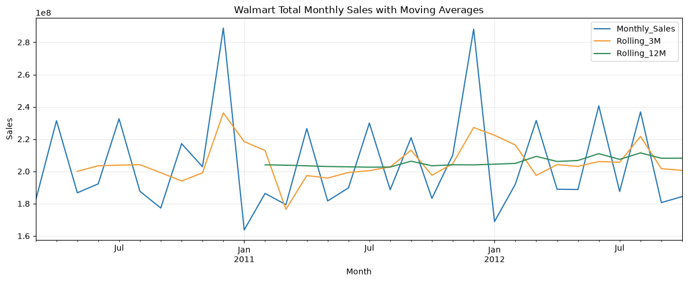
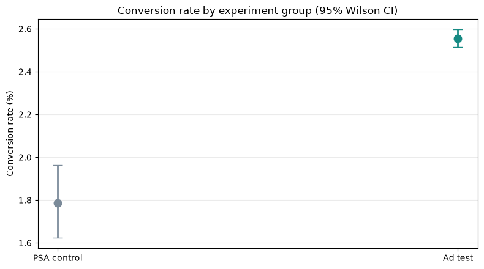

  

<h1 align="center">Data Analytics Portfolio</h1>

  <strong>Mohamed Fawzy</strong> 
  Ten project briefs · Excel · SQL · Python · Power BI · Statistical analysis

  <a href="https://www.linkedin.com/company/elevvopaths/">Elevvo Pathways</a> ·
  <a href="https://github.com/fawzy-911">GitHub profile</a>

## What this portfolio is

This repository documents ten tasks I completed during the Elevvo Data Analytics Internship. The work moves from spreadsheet reporting and exploratory analysis to relational SQL, web data collection, time series, Power BI and a controlled A/B test.

I try to keep one rule in view throughout: **define the row, the measure and the comparison before interpreting the chart.** That meant checking sales lines against distinct orders, aggregating one-to-many tables before joining, preserving survey blanks that came from conditional questions, and separating statistical significance from campaign profitability.

## Selected visual work

These are screenshots and charts exported from the project files—not mockups. Open any image to view it at full size.

### Task 8 · Power BI retail report

  
  
  

Executive Overview · Product &amp; Store Performance · Customer &amp; Returns Analysis

### Task 9 · Olist e-commerce report

  
  

Executive Overview · Sales &amp; Product Performance

  
  

Customer Cohorts &amp; Value · Delivery &amp; Customer Experience

### Two analysis charts

  
  

Task 7 · Monthly sales and moving averages &nbsp; | &nbsp; Task 10 · Conversion rates and 95% confidence intervals
`r`n`r`n## The ten projects

### 01 · Sales Performance Dashboard — Excel

**Brief:** turn Superstore transactions into a view of revenue, units, regions, categories and monthly performance. **Work:** kept raw and cleaned sheets, added date fields, built formula-based summaries and a filterable dashboard. **Evidence:** $2.297M revenue, $286.4K profit and 37,873 units from 9,994 sales lines; validation distinguishes those lines from 5,009 actual orders. [Open Task 1](./Task%201%20Sales%20Performance%20Dashboard%20Using%20Excel/)

### 02 · Titanic Exploratory Data Analysis — Python

**Brief:** inspect and clean the labelled passenger data, then compare survival patterns. **Work:** documented missing-value handling and charted survival by sex, ticket class, age and family group; this is descriptive analysis, not a prediction model. **Evidence:** overall survival was 38.4%; in this sample it was 74.2% for women and 18.9% for men, and decreased from 63.0% in first class to 24.2% in third class. [Open Task 2](./Task%202%20Exploratory%20Data%20Analysis%20on%20Titanic%20Dataset/)

### 03 · Customer Segmentation — RFM

**Brief:** group customers by recency, purchase frequency and spend. **Work:** cleaned transaction rows, scored the three measures with transparent quintile rules and assigned interpretable segments. **Evidence:** Champions were 21.72% of 4,338 customers but accounted for 64.56% of positive purchase value; Hibernating was the largest segment, with 1,074 customers. [Open Task 3](./Task%203%20Customer%20Segmentation%20Using%20RFM%20Analysis/)

### 04 · Survey Data Cleaning and Insights — Python

**Brief:** make a large survey file usable and extract clear findings. **Work:** audited missingness, duplicates and inconsistent text; retained structurally blank answers rather than filling them indiscriminately. **Evidence:** 25,973 respondent records, 369 columns, no exact duplicate rows, and 87.6% blank response cells—many from conditional questions. Python was the most selected regular programming language (21,860 respondents). [Open Task 4](./Task%204%20Data%20Cleaning%20and%20Insight%20Generation%20from%20Survey%20Data/)

### 05 · Product Sales Analysis — SQLite

**Brief:** answer product, regional revenue and monthly performance questions from a relational database. **Work:** wrote joins and aggregations, derived continent-level regions from billing country, and used `LAG()` for month-over-month changes. **Evidence:** 2,240 units and $2,328.60 revenue; Europe contributed $1,114.36. Product sales were tied at two units for many tracks, so the query uses documented tie-breakers instead of implying a clear runaway bestseller. [Open Task 5](./Task%205%20SQL-Based%20Analysis%20of%20Product%20Sales/)

### 06 · Job Posting Collection and Analysis — Python

**Brief:** collect public job listings and summarize roles, locations and skill mentions. **Work:** used `requests` and BeautifulSoup on an HTML listing page, checked `robots.txt`, deduplicated links and inspected a small sample of full descriptions. **Evidence:** a snapshot of 64 unique listings, with 15 descriptions analyzed; Engineering & IT was the largest grouped role family (24 listings). This is a dated sample from a remote-job board, not a census of the job market. [Open Task 6](./Task%206%20Web%20Scraping%20and%20Analysis%20of%20Job%20Postings/)

### 07 · Retail Sales Time Series — Walmart

**Brief:** break down sales over time and add a simple forecast. **Work:** converted weekly records to monthly totals, examined rolling means and calendar-month seasonality, compared departments and stores, and evaluated Holt–Winters smoothing on a chronological six-month holdout. **Evidence:** holdout MAPE was 14.25%. The dataset has no product SKU or named region, so department and store/type are used as clearly labelled proxies. [Open Task 7](./Task%207%20Time%20Series%20Breakdown%20of%20Retail%20Sales/)

### 08 · Retail Insights Dashboard — Power BI

**Brief:** model related sales tables and build an interactive report. **Work:** connected six sheets, separated sales from returns at the order-line grain, and built three report pages for executive, product/store, and customer/returns views. **Evidence:** the selected report view shows $2.79M sales, $844.66K profit and a 30.27% profit margin; In-Store represented 60.08% of sales. [Open Task 8](./Task%208%20Power%20BI%20Dashboard%20for%20Retail%20Insights/)

### 09 · E-commerce Business Insights — SQL Server, Python and Power BI

**Brief:** answer whether customers first seen in 2017 kept buying in 2018. **Work:** loaded nine Olist tables into SQL Server, aggregated child tables before joining, analyzed cohorts in Pandas and built a four-page Power BI report. **Evidence:** 662 of 43,025 customers acquired in 2017 placed another valid order during the observed part of 2018 (1.54%). The data ends on September 3, 2018, so this is a partial-year return rate; historical revenue per customer is not presented as predictive lifetime value. [Open Task 9](./Task%209%20Business%20Insights%20and%20Executive%20Report%20for%20E-Commerce%20Dataset/)

### 10 · Marketing Campaign A/B Analysis — Python

**Brief:** test whether the product ad converted better than the PSA control. **Work:** compared group-specific conversion rates with a two-proportion z-test and chi-square test, then reported Wilson/Newcombe confidence intervals. **Evidence:** 2.55% conversion for the ad group versus 1.79% for PSA, a 0.77 percentage-point lift (`p = 1.71 × 10⁻¹³`). A 100,000-user scenario implies about 769 extra conversions if the effect holds; the dataset has no revenue or campaign-cost fields, so it cannot establish ROI. [Open Task 10](./Task%2010%20Marketing%20Campaign%20AB%20Analysis/)

## How I approach the work

- **Start with the decision or question.** Choose a calculation because it answers that question, not because the tool offers it.
- **Respect the grain.** A transaction line, an invoice, an order and a customer are different units; joins and denominators must match the measure.
- **Keep cleaning explainable.** Preserve source files, record what changed, and avoid treating every blank as bad data.
- **Show the evidence and its limits.** A dashboard, correlation or small p-value is useful only when its scope and assumptions are clear.

## What I gained from the internship

The biggest value for me was learning to carry a question all the way through—not stopping when the code runs or the chart looks finished. Across ten different briefs, I practiced choosing the right tool for the job, checking whether a metric matches its label, and explaining what the data can and cannot support.

I am more comfortable now moving between Excel, SQL, Python and Power BI, and I have better habits around data grain, assumptions, validation and communicating results. Just as valuable, I finished with work I can open, explain and discuss—not only a list of tools I have used.`r`n`r`n## Tools used

**Excel** · **SQLite** · **SQL Server** · **Python** (`pandas`, `NumPy`, `Matplotlib`, `Seaborn`, `SciPy`, `statsmodels`, `requests`, `BeautifulSoup`) · **Power BI** · **DAX**

Each task folder contains its own deliverables and project notes. Dataset sources, reproduction steps and additional findings are documented there.

## About the program and this portfolio

The work was completed as part of the [Elevvo Data Analytics Internship](https://www.linkedin.com/company/elevvopaths/). The Elevvo logo mark is from the [official website](https://elevvo.tech/). This is my personal learning portfolio; it is not an official Elevvo publication or a claim that these internship exercises were deployed as company systems.

## Thank you
`r`n
My sincere thanks to Elevvo Pathways management and the team behind the Data Analytics Internship for organizing the program, preparing practical briefs and learning resources, and giving me the space to work through them at my own pace. The range of tasks helped me connect analysis techniques to real questions and build confidence in presenting my reasoning. I appreciate the opportunity and the work the team put into making it available.
---

Mohamed Fawzy · Data Analytics Portfolio · Updated November 2026

