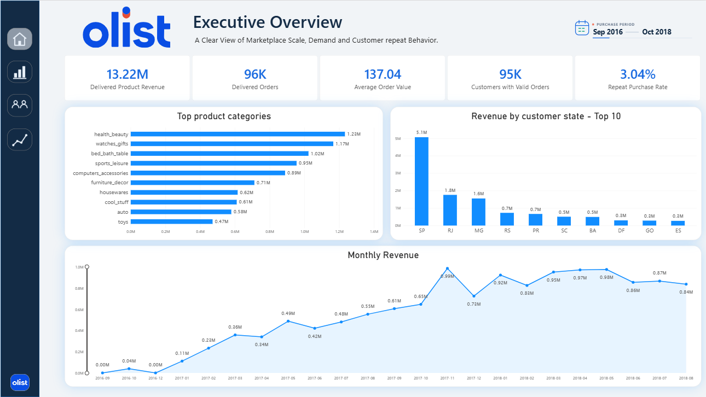
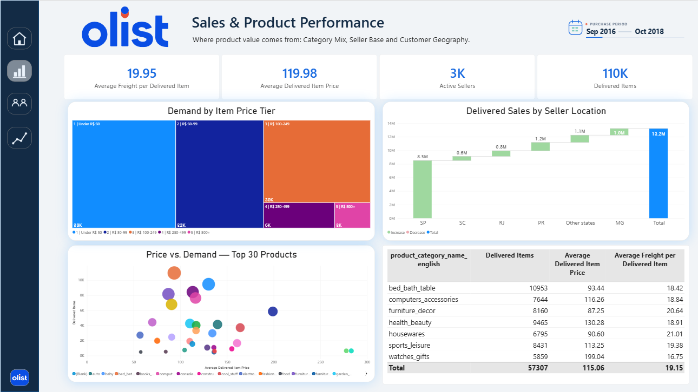
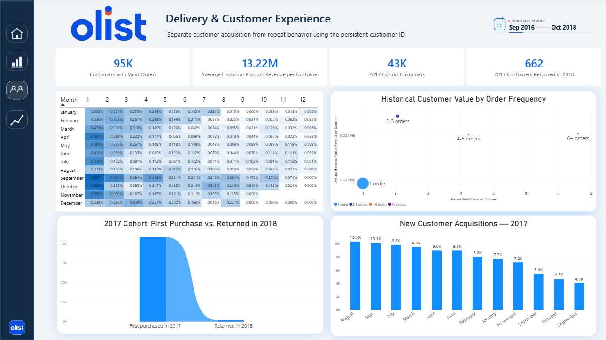
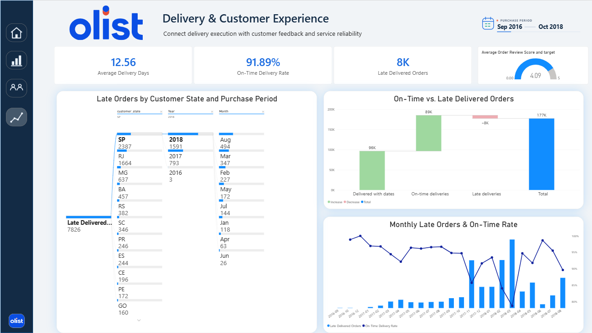
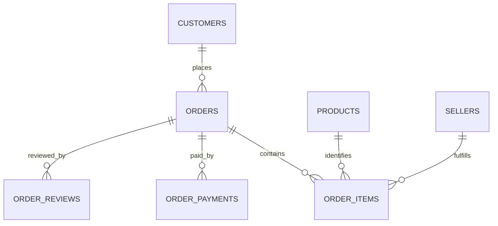
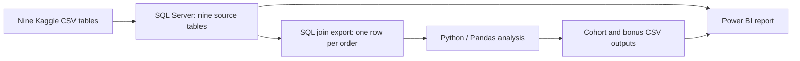

# Olist E-Commerce | Business Insights & Executive Report

**Task 9 — Industry Level** · SQL Server · Python / Pandas · Power BI

An end-to-end business analytics project answering the question:

> **Did customers acquired in 2017 continue buying during the observed part of 2018?**

The work follows the full data pipeline: nine Kaggle CSV tables → SQL Server database → controlled SQL joins → Python/Pandas cohort and bonus analysis → Power BI model, DAX measures and a four-page report.

**Source dataset:** [Brazilian E-Commerce Public Dataset by Olist on Kaggle](https://www.kaggle.com/datasets/olistbr/brazilian-ecommerce) — the raw CSVs are linked here instead of being repeated in the repository.

**Full project walkthrough:** [Olist end-to-end presentation](presentation/Task_9_Olist_Project_Presentation_Script_Aligned.pptx) — 14 slides covering the business question, source tables, SQL grain, Python cohort method, Power BI model and DAX roles, report pages, findings, recommendations and limitations.

**Screen recording:** [Watch the project walkthrough on Google Drive](https://drive.google.com/file/d/1ARckELa_V_bXbYjbGa5EpdQgsWX2ipyB/view?usp=sharing)

## Report pages

The images below are screenshots of the report built in Power BI Desktop.

### 1. Executive Overview



### 2. Sales & Product Performance



### 3. Customer Cohorts & Value



### 4. Delivery & Customer Experience



## End-to-end workflow

### Stage 1 — Source data from Kaggle

The source dataset above consists of nine separate CSV tables:

1. `olist_customers_dataset.csv`
2. `olist_geolocation_dataset.csv`
3. `olist_order_items_dataset.csv`
4. `olist_order_payments_dataset.csv`
5. `olist_order_reviews_dataset.csv`
6. `olist_orders_dataset.csv`
7. `olist_products_dataset.csv`
8. `olist_sellers_dataset.csv`
9. `product_category_name_translation.csv`

The nine raw CSVs are not included in the GitHub repository. Download them from the Kaggle link above and extract them locally before importing them into SQL Server.

They were loaded into SQL Server as separate tables, keeping the original relational structure. The SQL Server backup is not included. Recreate the database from the Kaggle source tables and the SQL script.

### Stage 2 — SQL Server database and joins

The nine source tables were imported into SQL Server. The query in [`Olist_SQL_Join.sql`](SQL%20Server/Olist_SQL_Join.sql) aggregates one-to-many tables by `order_id` **before joining**:

- `order_items`: product revenue, freight and item-row count;
- `order_payments`: total payment value;
- `order_reviews`: average order review score and review count.

Those summaries are joined to `orders` and `customers`. The exported analysis table is at **one row per order** (99,441 rows), so multiple item, payment or review rows do not multiply order-level records. Product revenue and payment value are retained as separate measures and are not added together.

### Stage 3 — Python and Pandas analysis

[`Olist_Ecommerce_Business_Insights.ipynb`](Olist_Ecommerce_Business_Insights.ipynb) reads the SQL join output, validates its grain, checks missing values and order statuses, and prepares separate populations for purchase activity, realized revenue, and delivery analysis.

- **Customer key:** `customer_unique_id` identifies a person across orders; `customer_id` identifies the order-linked customer record.
- **Valid purchase statuses:** `delivered`, `shipped`, `invoiced`, `processing`, and `approved`.
- **Excluded statuses:** `canceled`, `unavailable`, and `created`.
- **Realized product revenue and delivery:** delivered orders only; product revenue is the sum of item `price` and excludes freight.
- **Observation cutoff:** latest valid purchase is September 3, 2018. For the cohort heatmap, only complete months through August 2018 are used; unobserved future cohort periods are blank, not zero.

Pandas builds monthly customer cohorts, calculates follow-up retention, pivots the cohort results for analysis, and exports a long-format CSV for Power BI. The notebook also calculates the 2017-to-2018 return result, historical customer value, top 1% customer revenue share, and state-level delivery/review summaries.

### Stage 4 — Power BI data model and data sources

The Power BI report connects to the SQL Server database and imports the nine source tables. It also imports the cohort and bonus-analysis CSV exports created by Python. This preserves access to the source entities while using the Pandas cohort table for the retention visual.

The model is organized around the business grains: orders, order items, payments, and reviews are not treated as interchangeable rows. Customer and date dimensions support analysis by persistent customer identity and purchase period. The SQL join output is used as a validated order-level analysis/extract; the raw one-to-many tables remain separate in the database/model to avoid fan-out when aggregating. The first diagram shows source-table relationships; the second shows how the SQL export and Python outputs feed the report.





`geolocation` and `product_category_name_translation` are supporting lookup/source tables. The translation table provides English category labels. Geolocation is included in the source/database but not required for the state-level visuals shown here.

### Stage 5 — DAX and report design

DAX measures turn the model into reusable visual metrics. They cover delivered product revenue, delivered orders and items, customer counts, repeat-purchase rate, historical product revenue per customer, average delivery days, on-time rate, late deliveries, review score, and cohort return counts/rates. Supporting calculated tables/columns provide the date and customer cohort/frequency attributes, plus values needed to stage the cohort funnel and delivery waterfall.

The measures support consistent filtering and aggregation across the pages. For example, revenue is calculated at the item grain but filtered by delivered order status; customer repeat behavior uses persistent customer identity; and delivery metrics use delivered orders with the necessary dates. The report uses common visual types—cards, line/column, bar, treemap, waterfall, scatter, matrix heatmap, funnel, decomposition tree, and gauge—chosen to answer specific questions rather than decorate the page.

### Stage 6 — Power BI report pages

| Page | Business purpose | Main content |
| --- | --- | --- |
| **Executive Overview** | Give leadership a concise view of scale, demand, geography and repeat buying. | Revenue, delivered orders, customer and repeat-purchase KPIs; monthly revenue; top categories; revenue by customer state. |
| **Sales & Product Performance** | Compare item demand, price tiers, seller locations and category operating profile. | Delivered item and seller KPIs; treemap by item price tier; seller-location revenue waterfall; price-versus-demand scatter; category operating table. |
| **Customer Cohorts & Value** | Show acquisition cohorts, repeat behavior and observed customer value. | Cohort retention matrix, 2017-to-2018 funnel, 2017 acquisition trend, customer value by order-frequency band. |
| **Delivery & Customer Experience** | Connect delivery execution with customer feedback and identify where late orders concentrate. | Delivery-time, on-time, late-order and review KPIs; on-time/late waterfall; late-order decomposition; monthly late-order/on-time combo chart. |

The design uses an Olist-inspired blue/white identity, consistent page navigation, a shared purchase-period selector where appropriate, and titles that state the analytical purpose of each visual.

## Findings

### Core challenge: 2017 customers in observed 2018

| Metric | Result |
| --- | ---: |
| Customers whose first valid purchase was in 2017 | 43,025 |
| 2017 customers with another valid order during observed 2018 | 662 |
| Observed return rate | 1.54% |

This is a **partial-year observation**: the data ends on September 3, 2018. It answers whether customers returned during the observed part of 2018, not whether they returned at any time in the complete calendar year.

### Customer value and power users

| Metric | Result |
| --- | ---: |
| Customers in delivered-revenue analysis | 93,358 |
| Median observed product revenue per customer | R$89.73 |
| Mean observed product revenue per customer | R$141.62 |
| Repeat customers during the observed period | 2,801 (3.00%) |
| Top 1% group | 934 customers |
| Top 1% share of delivered product revenue | 11.47% |

This is **historical observed product revenue**, not profit or predictive CLV. The source does not include acquisition cost, product cost, margin or future purchases.

### Bonus: delivery time and review score

Across 27 states with both measures available:

- Pearson correlation between state-average delivery days and state-average review score: **−0.454**.
- Spearman rank correlation: **−0.490**.

The negative association is descriptive; it does not establish that longer delivery caused lower review scores. State averages can also reflect order mix, distance and different sample sizes.

## Business recommendations

1. Track repeat purchase by acquisition cohort and test post-purchase reminders or replenishment offers against a randomized holdout.
2. Investigate the top 1% customer segment, then add margin and service-cost data before making profitability claims.
3. Review delivery performance by state and drill into lanes and order characteristics before selecting operational interventions.
4. Reassess 2017 customer return rates when a full 2018 observation window or a longer customer history is available.

## Reproduce the pipeline

1. Download and extract the nine Kaggle CSV files.
2. In SQL Server, create/import the nine tables from their CSVs, preserving their table names and keys.
3. Run [`Olist_SQL_Join.sql`](SQL%20Server/Olist_SQL_Join.sql) in the SQL Server database. Export its result at one row per order to `SQL Server/customer_order_analysis.csv`.
4. Open the notebook in Jupyter or VS Code. The notebook reads `SQL Server/customer_order_analysis.csv` and writes its cohort output to `Python Output`. It regenerates `Python Output/cohort_retention_for_powerbi.csv`, `Python Output/power_users_top10_for_powerbi.csv`, and `Python Output/state_delivery_review_for_powerbi.csv`.
5. In Power BI Desktop, connect to the SQL Server database and import the three Python output CSVs. Open [`Dashboard.pbix`](Dashboard.pbix), update local source paths if prompted, refresh, and validate the KPIs against the notebook outputs.

Python libraries used: `pandas`, `numpy`, `matplotlib`, and `seaborn`.

## Repository files

```text
README.md
.gitignore
SQL Server/Olist_SQL_Join.sql
Olist_Ecommerce_Business_Insights.ipynb
SQL Server/customer_order_analysis.csv
Python Output/customer_order_payments.csv
Python Output/cohort_retention_for_powerbi.csv
Python Output/power_users_top10_for_powerbi.csv
Python Output/state_delivery_review_for_powerbi.csv
Dashboard.pbix
Python Output/cohort_heatmap_temp.png
assets/dashboard/*.png
```

The raw Kaggle CSV folder, SQL Server `.bak` backup, and temporary `.pptx-build` files are excluded from GitHub. The Kaggle dataset link above lets readers download the original data. The PBIX is the interactive deliverable; the four screenshots in `assets/dashboard/` are static previews.

## Task coverage

- **Cohort analysis:** monthly first-purchase cohorts and follow-up retention matrix.
- **Data modeling:** nine source tables retained in SQL Server; order-grain join result with one-to-many child tables aggregated before joining.
- **Customer lifetime value:** historical product revenue per customer is used as a clearly labeled descriptive proxy, not a predictive CLV model.
- **Bonus 1:** delivery time by state compared with order review score, with Pearson and Spearman correlation.
- **Bonus 2:** top 1% of customers ranked by delivered product revenue and their share of total delivered product revenue.
- **Visualization:** four-page Power BI report with interactive filtering and complementary visuals.


